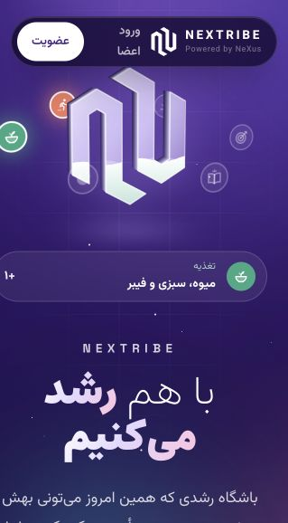
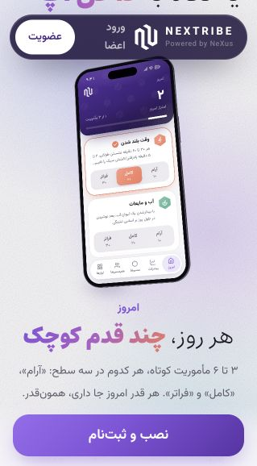
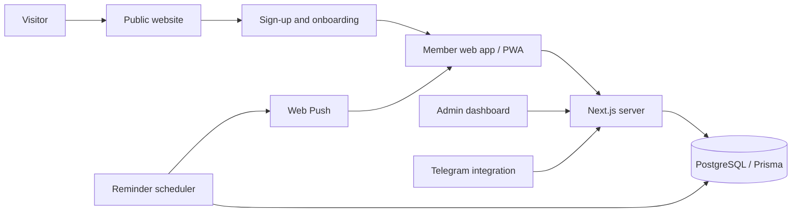

# NEXTRIBE
### Public website + installable web super-app

**Created and built by Arman Naseri Far** · Persian / RTL · Mobile-first · Private source code

[Visit the website](https://nextribe.app/welcome) · [Explore the interactive app preview](https://nextribe.app/welcome#inside-app) · [Open member login](https://nextribe.app/login)

NEXTRIBE brings everyday personal-growth tools into one web experience. A public website introduces the club and its six paths; the member app turns those paths into small daily actions, planning, progress and shared encouragement.

## See the product without repository access

The public website includes an interactive preview of **Today, Planner, Progress and Tribe**. Visitors can explore it without signing in. The full member app requires an account; the public preview uses demonstration content.

| Public website | Interactive app preview |
| --- | --- |
|  |  |

*Screenshots captured from the public website on 30 October 2026. The app image shows the website's interactive demonstration, not a member's private account.*

**A quick walkthrough**
1. Open the [public website](https://nextribe.app/welcome) to see the brand, six paths and membership flow.
2. Scroll to [the app preview](https://nextribe.app/welcome#inside-app). Try a mission level and switch between the four preview sections.
3. Explore the [public resource library](https://nextribe.app/resources).
4. See the [installation guide](https://nextribe.app/welcome#install) or [member login](https://nextribe.app/login) for the full app.

## The product

| Surface | Purpose |
| --- | --- |
| **Public website** | Explains the growth club, introduces the six paths, demonstrates the app and guides visitors through installation and sign-up. |
| **Web super-app / PWA** | Combines daily missions, planning, progress, personal tools and community in an interface that can be installed from the browser. |
| **Administration** | Supports member and content management, feedback, feature access and engagement reporting. |
| **Telegram integration** | Provides an additional membership and onboarding channel. |

The six paths are **Body, Nutrition, Sleep, Learning, Focus and Calm**. Members choose goals and complete small missions at three effort levels. A reduced plan supports difficult days; progress is designed around personal goals and consistency.

The broader app includes a daily planner, focus timer, breathing exercises, sleep logging, home exercise, food logging, hydration and caffeine tracking, screen-time logging, reminders, a media library and community features. AI-assisted features have configurable access and usage limits; availability can vary by member and rollout stage.

## My role

I designed and built NEXTRIBE across the public website and the member application, including:

- Persian RTL interfaces, mobile layouts and a shared visual system.
- Daily missions, planning and progress experiences.
- Full-stack data flows with PostgreSQL and Prisma.
- Member authentication, onboarding and administrative tools.
- Browser installation, personal Web Push reminders and Telegram integration.

## Engineering overview

| Area | Implementation |
| --- | --- |
| Application | Next.js App Router, React, TypeScript |
| Interface | Tailwind CSS, Persian typography, RTL layouts, light and dark themes |
| Data | PostgreSQL with Prisma |
| App delivery | Progressive Web App, web manifest and service worker |
| Notifications | Web Push with a scheduled reminder service |
| Integrations | Telegram bot and configurable AI-assisted features |

**Design decisions**

- **One product, two entry points:** the public website helps visitors understand the experience; the member app supports repeated daily use.
- **Installable through the browser:** members can use a phone home-screen experience without an app-store download.
- **Personal and shared experiences:** individual reflection and tracking are separated from community participation.
- **Controlled feature rollout:** access settings and usage limits allow features to be introduced selectively.

## Scope and access

The website and its demonstration are public. The application source repository remains private. This case study shares product-level descriptions and public screenshots only; it does not include source code, credentials or member records.

This is a product and engineering overview, not a claim of measured health outcomes or user-growth metrics.

## Resume summary

> Designed and built NEXTRIBE, a Persian RTL personal-growth platform combining a public website with an installable web super-app. Implemented daily missions, planning and progress tools, member administration, Web Push reminders and Telegram onboarding using Next.js, React, TypeScript, PostgreSQL and Prisma.

[Back to my GitHub profile](https://github.com/Armannss) · [LinkedIn](https://www.linkedin.com/in/arman-naseri-far-5773b3341/)
